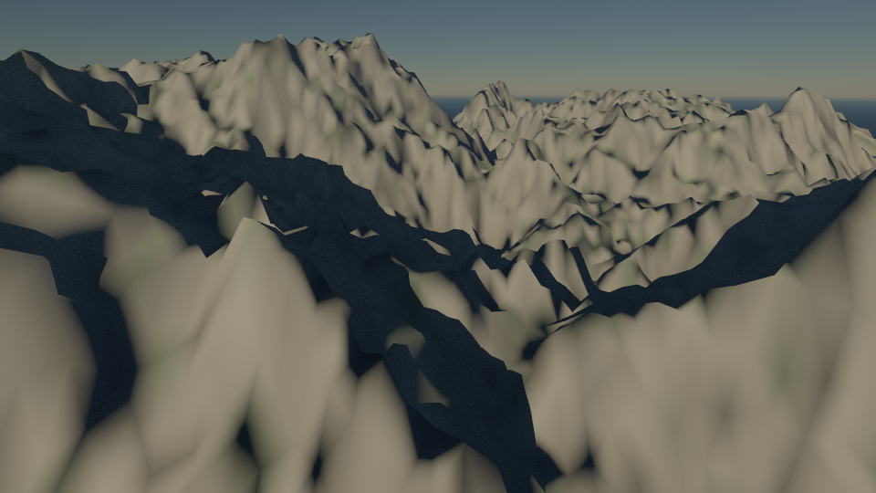
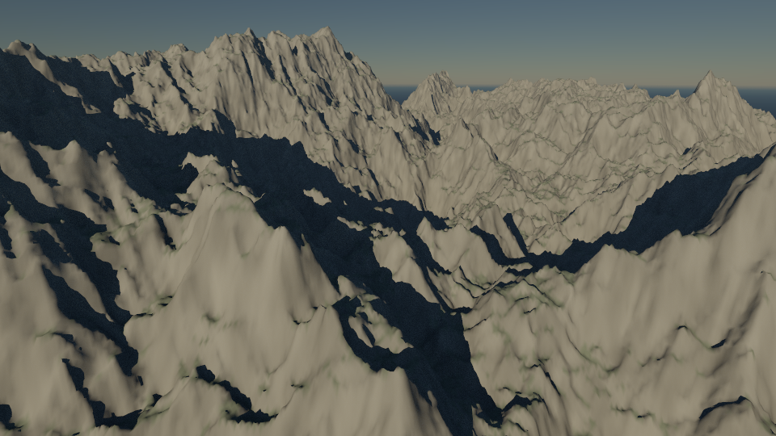

# Visual-quality record

## W3.S2 — resolve the landform

Development build 0.3.0-dev.2 introduces final geometry independent of the
interactive preview. This is a geometric-detail milestone, not the completed
photographic-quality target. The next slice addresses per-hit geological surfaces.

Original scene: [Sunlit ridges](site/assets/sunlit-ridges.lithosky), seed 9837,
1024² source cells, fixed camera/physical sun/materials, 960 × 540, 32 samples.
These are unretouched application exports; no generated marketing imagery or
third-party textures are used. The scene uses existing terrain and surface tools.

### Draft — 128² cells



### Fine — 1024² cells



[View the 512² middle tier](site/assets/terrain-512.png). At native image size,
compare the central distant ridge and right-hand mountains: Fine resolves smaller
crests, gullies and the shadows they cast. The foreground still looks too smooth
and the rock is too uniform. Lighting/exposure and material richness remain below
the product target. Geometry alone does not make this scene photographic.

### Measured cost

Local Chrome 155 on Apple Metal 3, macOS arm64. Times include UI interaction,
fresh final worker generation/preparation, shader setup, tracing and readback.
These are individual observations, not a cross-device benchmark or timing promise.

| Final cells | Triangles | End-to-end time |
|---|---:|---:|
| 128² | 32,768 | 4.79 s |
| 512² | 524,288 | 7.25 s |
| 1024² | 2,097,152 | 9.01 s |

Detailed is the default; Fine needs about 48.1 MiB of vertex storage on both the
CPU during preparation and GPU during rendering, plus image/hierarchy/atmosphere
and worker resources. See [rendering budgets](rendering.md).

### Correctness and provenance

The [capture record](site/assets/terrain-captures.json) includes the scene,
source/image hashes, hardware/browser and measurements. All 816 CPU/GPU
intersection probes at 128²/256²/512²/1024² pass the 0.002-unit tolerance; worst
observed error is below 0.00001 units. The isolated preparation timings reuse the
worker source cache after the first tier, so they are not cold-start comparisons.

An independent analytic fixture places an eight-unit ridge between Draft vertices:
Draft misses the ridge, while Fine hits its peak and grazing silhouette. Plane,
edge, parallel, source-cap, cancellation and sculpt-replay fixtures also pass.
Browser checks cover cancellation during preparation, scene edits invalidating
pending work, injected large-buffer allocation failure and successful retry.

Reproduce with an isolated rebuilt app:

```sh
PLAYWRIGHT_CLI=/path/to/playwright-cli node docs/capture/detail-run.mjs http://127.0.0.1:PORT
```

Open the downloaded scene and select the desired Terrain detail, image size and
sample count; transient render settings are not stored in scene files. Inspect
[the revised roadmap](../ROADMAP.md) for the subsequent material/light/sky gates.
