# Visual-quality record

## W3.S2 — resolve the landform

Development build 0.3.0-dev.2 introduces final geometry independent of the
interactive preview. This is a geometric-detail milestone, not the completed
photographic-quality target. The next slice addresses per-hit geological surfaces.

Original scene: [Sunlit ridges](site/assets/sunlit-ridges.lithosky), seed 9837,
1024² source cells, fixed camera/physical sun/materials, 960 × 540, 32 samples.
These are unretouched application exports; no generated marketing imagery or
third-party textures are used. The scene uses existing terrain and surface tools.

### Draft — 128² cells


### Fine — 1024² cells


[View the 512² middle tier](site/assets/terrain-512.png). At native image size,
compare the central distant ridge and right-hand mountains: Fine resolves smaller
crests, gullies and the shadows they cast. The foreground still looks too smooth
and the rock is too uniform. Lighting/exposure and material richness remain below
the product target. Geometry alone does not make this scene photographic.

### Measured cost

Local Chrome 155 on Apple Metal 3, macOS arm64. Times include UI interaction,
fresh final worker generation/preparation, shader setup, tracing and readback.
These are individual observations, not a cross-device benchmark or timing promise.

| Final cells | Triangles | End-to-end time |
|---|---:|---:|
| 128² | 32,768 | 4.79 s |
| 512² | 524,288 | 7.25 s |
| 1024² | 2,097,152 | 9.01 s |

Detailed is the default; Fine needs about 48.1 MiB of vertex storage on both the
CPU during preparation and GPU during rendering, plus image/hierarchy/atmosphere
and worker resources. See [rendering budgets](rendering.md).

### Correctness and provenance

The [capture record](site/assets/terrain-captures.json) includes the scene,
source/image hashes, hardware/browser and measurements. All 816 CPU/GPU
intersection probes at 128²/256²/512²/1024² pass the 0.002-unit tolerance; worst
observed error is below 0.00001 units. The isolated preparation timings reuse the
worker source cache after the first tier, so they are not cold-start comparisons.

An independent analytic fixture places an eight-unit ridge between Draft vertices:
Draft misses the ridge, while Fine hits its peak and grazing silhouette. Plane,
edge, parallel, source-cap, cancellation and sculpt-replay fixtures also pass.
Browser checks cover cancellation during preparation, scene edits invalidating
pending work, injected large-buffer allocation failure and successful retry.

Reproduce with an isolated rebuilt app:

```sh
PLAYWRIGHT_CLI=/path/to/playwright-cli node docs/capture/detail-run.mjs http://127.0.0.1:PORT
```

Open the downloaded scene and select the desired Terrain detail, image size and
sample count; transient render settings are not stored in scene files. Inspect
[the revised roadmap](../ROADMAP.md) for the subsequent material/light/sky gates.

## W3.S3 — geological surfaces

Development build 0.3.0-dev.3 adds solid per-hit geological definitions.
The original [Weathered highlands scene](site/assets/weathered-highlands.lithosky)
uses the same seed, geometry, camera, sun and 32 samples at 960 × 540 for the
paired views below; only the geological model is enabled/removed. Source settings,
saved-scene checks and image hashes are in the
[material capture record](site/assets/material-captures.json).

Simple:

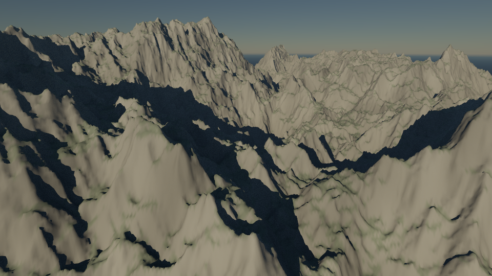

Geological:

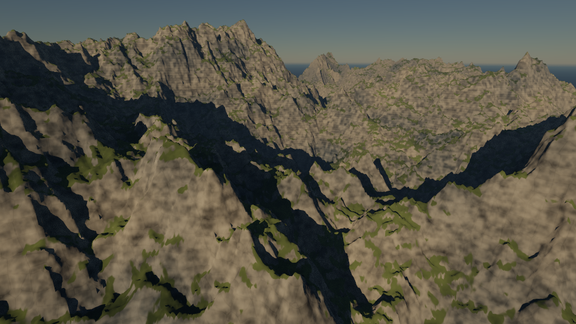

### Foreground — native 256 × 128 crops

Simple:

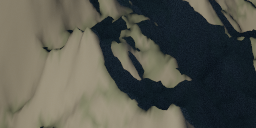

Geological:

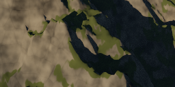

### Middle — native 256 × 128 crops

Simple:

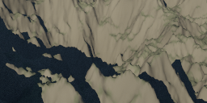

Geological:

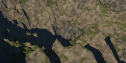

### Horizon — native 256 × 128 crops

Simple:

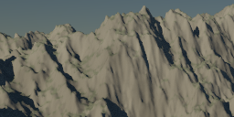

Geological:

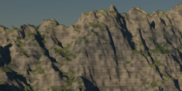

The new model breaks up the previously uniform stone with layered tone, angular
joints, mineral grain and bump relief. Soil and snow have distinct variation and
roughness. Review at native size: the geometry silhouettes are unchanged, and
fine texture attenuates toward the horizon. The image still has simplified light,
deep shadows and a restrained sky; it does not meet the complete photographic
target. Full transport, glossy response and exposure remain W3.S4.

### Material reference views

These closer views use the same camera, 60° daylight sun and terrain with three
different presets; water is disabled to expose the surface. Their light and camera
differ from the paired landscape views and are recorded per image in the manifest.

[Rock](site/assets/material-rock.png) · [Ground](site/assets/material-ground.png) ·
[Snow](site/assets/material-snow.png). These are original, unretouched application
exports, not downloaded textures or generated marketing images.

### Local observations

Apple Metal 3 / Chrome 155 on macOS arm64. Fine (1024²), 960 × 540, 32 samples;
individual end-to-end observations include worker preparation, pipeline setup,
tracing and readback. Some CPU checks ran during capture, so these are neither
isolated GPU timings nor general performance guarantees.

| View | End-to-end time |
|---|---:|
| simple | 6.79 s |
| geology | 6.39 s |
| rock | 6.14 s |
| ground | 6.15 s |
| snow | 7.09 s |

The shader material probe compares 400 samples (3,200 scalar outputs) across five
presets, both palettes, several seeds including the maximum value and several footprints with the
CPU evaluator. Maximum observed absolute difference is below 0.000055 against a
0.003 tolerance. Unit checks independently verify gradients, joint search, normal
limits, filtering continuity and rough-diffuse reciprocity/integrated reflectance.
The diffuse tests do not establish conservation for the entire bumped integrator.

Reproduce using `docs/capture/material-run.mjs` against an isolated rebuilt app.
See [geological surface controls and limits](geological-surfaces.md).

## W3.S4: light transport and color

The [Radiant highlands scene](site/assets/radiant-highlands.lithosky) retains the
previous geological terrain, camera, sun and surface. Studio lighting adds the
new bounded diffuse/GGX dielectric path integrator and exposure/filmic transform.
The [capture record](site/assets/lighting-captures.json) contains the exact scene
for every image, source/scene/PNG hashes, browser/GPU, settings, time, image
statistics and actual shader probes. All are original unretouched app exports.

| Classic path and fixed display | Studio transport and filmic display |
|---|---|
|  | 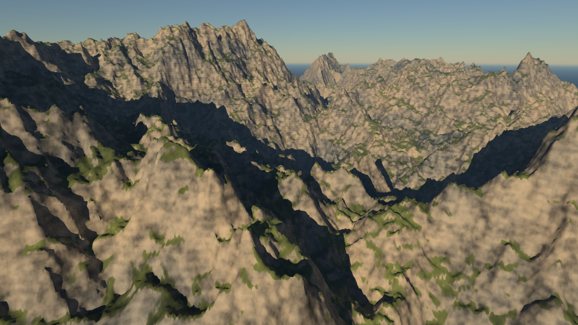 |

This pair changes both transport and display. To isolate terrain interreflection,
compare [one surface vertex](site/assets/lighting-direct.png) against
[three](site/assets/lighting-studio.png), both at +2.75 EV with the same filmic
curve and all other parameters equal. The ravines gain indirect illumination;
this is a modest improvement, not photographic realism. Smooth procedural
landforms, surface transitions, an untextured sky and limited water remain visible
limitations. The new conservative surface mixture is intentionally energy-losing;
it does not model a fully layered rock coating.

[One additional exposure stop](site/assets/lighting-exposure.png) lifts the entire
image while preserving a soft highlight shoulder. The
[authored warm rectangle](site/assets/lighting-area.png) adds a local foreground
fill. Its placement/direction/size/radiance are recorded with that image. These
are control studies, not compositional recommendations or a substitute for the
integrated gallery review in W3.S6. Grain remains visible at 64 samples, especially
in area-light shadows; no denoiser or postprocessing conceals it.

All five benchmarks use 960 × 540, 64 samples and 1024² final terrain. Their
unretouched exports contain no fully black or fully white pixels at the chosen
settings. That numerical check detects gross clipping/crushing, not artistic
quality. High exposure or directly visible emitters can still quantize to white
in 8-bit output. See the [working space and transform](light-transport.md).

On the recorded Apple Metal 3 / Chrome 155 run, end-to-end observations were
12.29 s classic, 13.04 s one vertex, 18.17 s three vertices, 17.61 s exposure +1,
and 20.93 s with the rectangle. These include preparation and shader setup, not
isolated GPU timing. The dark-tail (1st percentile) display luminance rises from
21 to 24 when enabling terrain interreflection at identical exposure. The
additional exposure stop raises it to 37 while the 99th percentile rises from
175 to 206, leaving highlight headroom in this scene.

## Lake optics and rendering workflow (W3.S5)

The original [Silver basin](site/assets/silver-basin.lithosky) scene uses the
current v9 rendering models. The [classic-water export](site/assets/water-classic.png)
and [lake-optics export](site/assets/water-ripples.png) share terrain, camera,
lighting, exposure, 960 × 540 output, 64 samples and 1024² geometry. Only the
water model changes. The new model separates blue deep water, visible shallow
bed, terrain reflections, filtered normal ripples and a damp land-side shoreline.
It does not displace the mean water surface or add foam/caustics.

Additional controls are demonstrated by [calm water](site/assets/water-calm.png),
[lower optical density](site/assets/water-clear.png), and a deliberately changed
camera for the [grazing shoreline](site/assets/water-grazing.png). The latter is
an additional composition, not a same-camera quality comparison. Exact scenes
and settings are included per image in the [capture record](site/assets/water-captures.json).
The [256-sample export](site/assets/water-clean.png) shares the ripple scene's
camera, geometry and display settings; additional samples reduce stochastic
noise without denoising or smoothing the terrain.

New starter scenes use the current models. An older file's resolution/sample
settings do not upgrade its materials or lighting; **Upgrade rendering** is the
explicit undoable route. The upgrade now converts the actual legacy light vector
rather than moving the sun to an unrelated azimuth. Idle WebGPU lighting preview
uses the exact final kernels at 320 × 180 / 16 samples / 128² terrain. It reduces
surprises in water color and illumination while remaining a coarse view.

The user's supplied scene was reproduced privately with the same camera, terrain,
water level and sunlight direction. It is not part of the public gallery or
repository. The lake remains visibly water in the upgraded still and exported
PNG. Original files are retained. These results improve the specific failure;
they are not a claim that the overall renderer has reached photographic quality.
Finite-patch horizon artifacts, procedural surface repetition, clear single-
scattering skies and missing vegetation/clouds remain visible. W3.S6 owns the
larger camera/composition review; later waves add the sky and ecological systems.

Measurements in the S1–S4 sections above describe those slices' original runs.
Refreshed capture manifests contain the current build's hashes and local timings.

## W3.S6 — compose through a saved lens

Build 0.3.0-dev.6 adds lens/target/roll/framing, traced depth of field and render
regions. The original [Amber ridges](site/assets/mountain-composition.lithosky),
[Tidal light](site/assets/coast-composition.lithosky) and
[Daylight snow](site/assets/snow-composition.lithosky) scenes demonstrate the
controls at a 2048-pixel long edge, 64 samples and 1024² final terrain.
They are downloadable starting points in the app and generated gallery.

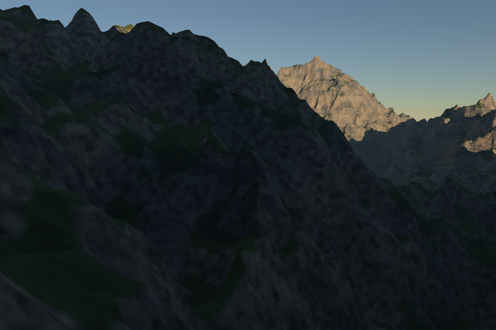

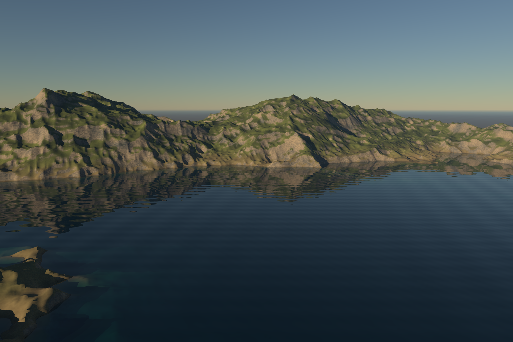

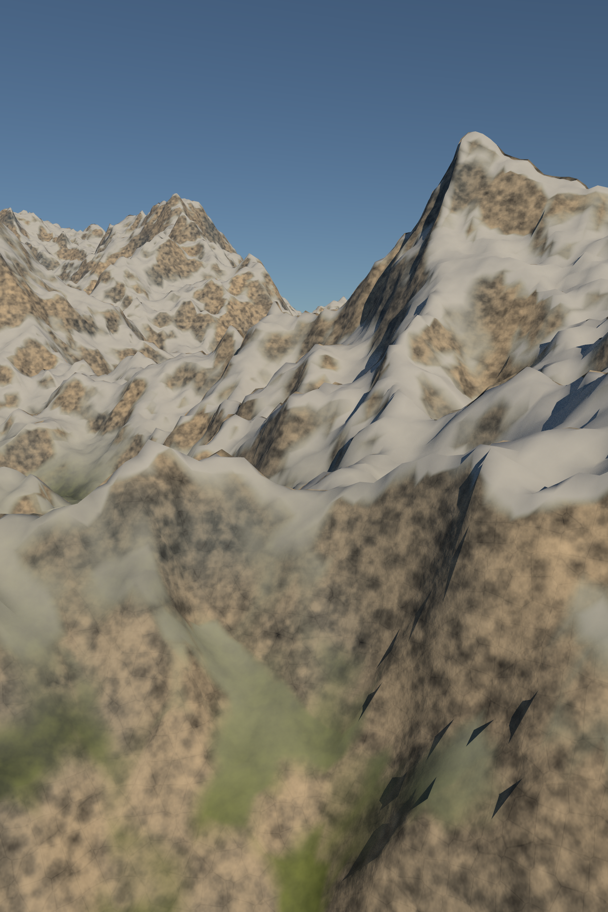

These are original, unretouched renderer exports. They are new compositions,
**not identical-camera before/after comparisons** against previous slices.
Their [capture record](site/assets/camera-captures.json) stores exact scenes,
source/image hashes, dimensions, settings, GPU/browser, timing and image-buffer
budgets. The gallery links unscaled 256×128 foreground, middle and horizon crops
from each export. The pinhole/thin-lens pair changes only aperture enablement;
its deliberately small camera scale makes blur visible without claiming that
a kilometre-scale landscape should look like a miniature.

### Integrated review: photographic gate remains open

The camera implementation is complete locally. **The larger visual acceptance
target has not passed.** A correct lens and more output pixels expose the
current renderer’s limitations; neither supplies convincing geology by itself.

| Criterion | Review and work still required |
|---|---|
| Geology and silhouette | Fine geometry resolves crests, but ridges repeat and broad slopes remain smooth. More coherent drainage/erosion and rock structure are needed. |
| Material scale and variation | Solid textures remain visibly mottled; slope-based green patches and smooth snow read as procedural masks. Improve macro/micro structure and snow/rock transitions. |
| Light and highlights | Exposure is controllable and highlights retain color. Golden-hour shadows still show grain and insufficient natural fill. Evaluate richer sky illumination and sampling. |
| Atmospheric depth | Layering is limited and the finite terrain meets an approximate planet background. A horizon band can remain; distant terrain/environment continuity needs a real solution. |
| Water and shore | Reflections and depth separate the lake from land. The coastal study still uses a bounded lake plane, with no ocean boundary, surf or displaced waves. |
| Noise and aliasing | 64 samples retain visible shadow noise at native resolution. Higher counts reduce stochastic noise; they do not fix smooth geology, texture repetition or a horizon discontinuity. |
| Composition | Saved landscape/portrait lenses and editable targets make framing possible. The examples remain development studies, below the intended photographic standard. |

The next rendering corrections must address those defects directly, retaining
the same saved cameras for comparison. Clouds or vegetation must not conceal
unresolved bare-landscape problems. Wave 3 cannot be advertised as
photographically convincing on this evidence. The later night/cloud work
remains planned and is not included in these images.

### Correctness and bounded output

Actual WGSL camera rays match 4,096 CPU-reference scalar values within 0.00005
relative/absolute tolerance. Full-frame and region renders match byte for byte
over 16,435 crop pixels, both with and without aperture sampling. Thin-lens CPU
tests verify rays from different aperture positions meet at the same focal-plane
point; central picking and rolled/panned projections agree across all frames.
These checks validate camera math and crop consistency, not photographic merit.

Complete first samples at 2048×1152, 1365×2048 and 2048² verify bounded allocation
and cancellation. Image-buffer budgets are respectively 54.0, 64.0 and 96.0 MiB,
plus terrain and other process resources. The UI also completes and downloads a
1365×2048 PNG and a separately labeled cropped PNG. Focus/pan/Undo, gesture
cancel, save/reopen/recovery, mobile layout and WebGL camera editing are tested.
Reproduce with `docs/capture/camera-run.mjs` against an isolated rebuilt app.

Local Chrome 155 / Apple Metal 3 observations include preparation, shader setup,
tracing and readback; they are individual runs, not performance guarantees:

| Composition | Output | Samples / terrain | Time | GPU image buffers |
|---|---|---|---:|---:|
| Amber ridges | 2048 × 1365 | 64 / 1024² | 91.29 s | 63.98 MiB |
| Tidal light | 2048 × 1365 | 64 / 1024² | 56.26 s | 63.98 MiB |
| Daylight snow | 1365 × 2048 | 64 / 1024² | 77.11 s | 63.98 MiB |

Each Fine field adds about 48.1 MiB of GPU vertex storage. CPU upload/readback
copies, worker cache, preview, LUTs and driver overhead are additional.
